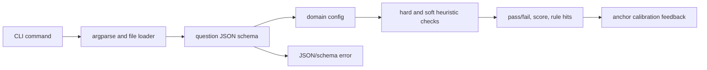
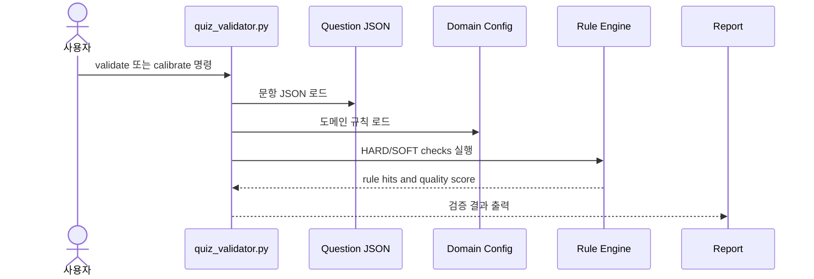

# Quiz Validator Learning Guide

## 1. 문제 정의

AI가 생성한 객관식 문제가 특정 문체, 금지 표현, 선택지 길이 편차, 설명 패턴 같은 detectable signal을 반복하는 문제를 투명한 규칙 기반 검증기로 잡아내는 프로젝트입니다.

## 2. 프로젝트 유형

- 유형: CLI 검증 도구 + AI 출력 평가 + schema/config 기반 품질 게이트
- 핵심 역량: Python CLI, JSON schema, heuristic evaluation, calibration, AI output governance

## 3. 프로젝트 맞춤형 상호작용 구조 시각화

### 상호작용 표

| 트리거/행동 | 입력/상태 | 처리 컴포넌트 | 데이터/모델/외부 접점 | 출력/산출물 | 검증 신호 | 실패/예외 처리 |
|---|---|---|---|---|---|---|
| 단일 문항 검증 | question JSON | `quiz_validator.py` | domain config JSON | pass/fail, score, rule hits | schema parse, rule count | JSON 오류, 필수 필드 누락 |
| 배치 검증 | questions directory | batch runner | multiple question files | aggregate report | hard pass rate, avg score | 개별 파일 오류 표시 |
| anchor calibration | anchor sample set | `--calibrate` mode | public anchor questions | calibration result | anchor HARD pass rate | rule threshold 조정 필요 |
| 답안 분포 점검 | questions directory | `answer_distribution.py` | correct answer letters | chi-square signal | distribution warning | 표본 부족 안내 |
| 새 도메인 추가 | new config | copied domain JSON | domain-specific banned words/rules | reusable validator domain | anchor pass, quality score | 과도한 rule tuning 경고 |

### CLI 평가 흐름



### 검증 시퀀스



## 4. 아키텍처

- `quiz_validator.py`: 문항 검증 CLI의 중심
- `answer_distribution.py`: 정답 분포 통계 확인
- `aws-saa.json`: 도메인별 검증 규칙 설정
- `anchor_aws_saa.json`: calibration 기준 샘플
- `_schema.md`: config와 question 형식 문서

## 5. 데이터 흐름

```text
question JSON -> schema checks -> domain config -> hard rules -> soft scoring -> report/calibration feedback
```

## 6. 핵심 코드 해부 순서

1. `_schema.md`: 입력 데이터가 어떤 구조여야 하는지 먼저 봅니다.
2. `aws-saa.json`: 규칙이 코드에 박혀 있지 않고 config로 분리된 이유를 이해합니다.
3. `quiz_validator.py`: HARD fail과 SOFT score가 어떻게 계산되는지 봅니다.
4. `answer_distribution.py`: 문항 품질을 단일 문항이 아니라 세트 단위로 보는 이유를 봅니다.

## 7. 설계 이유와 대안

- heuristic 기반: 빠르고 투명하며 면접에서 규칙별 판단 근거를 설명하기 쉽습니다.
- config 기반: AWS 외 PMP, CFA, LEET 같은 다른 도메인으로 확장할 수 있습니다.
- ML classifier 대안: 더 복잡한 패턴은 잡을 수 있지만, 작은 데이터와 설명 가능성 측면에서 현재 단계에는 과합니다.

## 8. 테스트/검증

```bash
python quiz_validator.py --domain aws-saa.json --calibrate
python quiz_validator.py --domain aws-saa.json path/to/question.json
python answer_distribution.py questions_dir/
```

## 9. 취약점/개선점

- 규칙을 아는 사용자는 우회할 수 있습니다.
- semantic quality와 factual correctness는 별도 검증기가 필요합니다.
- schema pass rate, hallucination signal, answer faithfulness 같은 AI eval 지표와 연결하면 더 강해집니다.

## 10. 직접 해볼 변형 과제

1. 새 도메인 config를 하나 추가하고 anchor 5개로 calibration합니다.
2. HARD rule 하나와 SOFT signal 하나를 추가합니다.
3. batch 결과를 CSV로 저장하는 옵션을 추가합니다.

## 11. 면접 대비

### 30초 설명

quiz-validator는 AI가 만든 객관식 문항에서 반복적으로 드러나는 문체와 구조적 신호를 규칙 기반으로 검증하는 Python CLI 품질 게이트입니다.

### 2분 설명

이 프로젝트는 생성형 AI를 단순히 사용하는 것이 아니라, 생성 결과를 검증하는 습관을 보여주기 위해 만들었습니다. 문항 JSON과 도메인 config를 입력받고, HARD rule은 즉시 fail 기준으로, SOFT rule은 품질 점수로 계산합니다. 또한 anchor sample calibration과 정답 분포 검사를 통해 단일 문항뿐 아니라 문항 세트의 품질도 확인합니다. 투명한 heuristic 구조라서 어떤 규칙 때문에 실패했는지 설명할 수 있다는 점이 핵심입니다.
